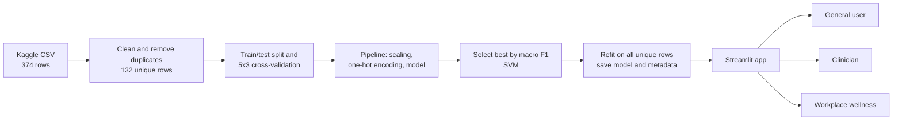

# ML_Sleep_Disorders_Classification
An explainable sleep-disorder screening tool with three views (general user, clinician, workplace wellness), built on a leakage-corrected evaluation of the Sleep Health and Lifestyle dataset (2023; KAGGLE).

# Sleep Screening Assistant

Built as an AI internship project at XTRAGRAD AI by ARATRIKA BHATTACHARYA.

> **Screening and decision support only. This is not a diagnosis and does not replace a doctor.** The model is trained on a small synthetic dataset.

---

## 1. Project Overview

The Sleep Screening Assistant takes basic lifestyle and health details (age, sleep duration, stress, activity, blood pressure and so on) and predicts one of three patterns: **no sleep disorder, insomnia, or sleep apnea**. Along with the prediction it shows how likely each pattern is and **which inputs pushed the result**.

One trained model serves three audiences through three different views:

| View | Who it is for | What it shows |
|---|---|---|
| General user | Anyone checking their own sleep | Plain-language result, confidence level, top reasons, simple sleep tips |
| Clinician | Doctors and sleep specialists | Class probabilities, input-effects chart, model reliability and limits |
| Workplace wellness | HR and wellbeing teams | Grouped patterns across a team. Individuals are never shown, and groups under 5 people are hidden |

## 2. Problem Statement

Sleep disorders such as insomnia and sleep apnea are common and often go undetected. The standard diagnostic, polysomnography, is expensive and needs specialist interpretation, which is why many studies look for cheaper screening from routine lifestyle and health data.

Existing machine-learning projects on this topic leave four gaps:

1. **A label with no reason.** Most tools output "insomnia" or "sleep apnea" without saying why, which makes them hard to trust in a health setting.
2. **One interface for everyone.** A patient, a clinician and a workplace wellbeing team need different information, but existing tools offer a single form.
3. **Questionable evaluation.** The popular public dataset is small and contains many duplicate rows. When duplicates land in both training and test sets, accuracy looks far better than it really is.
4. **Overconfident presentation.** Tools rarely say how reliable a single prediction is, or warn when an input is outside what the model has seen.

## 3. Proposed Solution

The project addresses each gap directly:

1. **Per-prediction explanations.** For every prediction, the app swaps one input at a time with typical values from the data and measures how the predicted probability changes. Users see the top reasons in plain language, and clinicians see a full effects chart.
2. **Three views from one model.** The same saved model feeds a general-user view, a clinician view and an aggregate workplace view.
3. **Honest evaluation.** Duplicates are removed before any split, models are compared with repeated cross-validation, and a majority-class baseline is included.
4. **Honest presentation.** The app shows a confidence level, marks low-confidence results as "unclear" instead of reassuring, warns about out-of-range inputs, and says when blood pressure or heart rate were assumed.

## 4. Uniqueness

- **Leakage-aware pipeline, measured.** Only 132 of the 374 rows are unique. We measured that with a naive split, **88.3% of test rows had an identical twin in the training set**, and a Random Forest scored **94.7%**. After removing duplicates, the same model scores about 59% in cross-validation. The reference papers describe the dataset as 400 rows; the public file we downloaded has 374, and we could not reproduce their setups exactly, so we verified duplicates ourselves.
- **Explanation inside the product, not just in a paper.** Several studies discuss feature importance in charts. Here the explanation is part of the interface that the user sees, for each person.
- **Audience-specific views.** In our survey of existing work (section 6) we found no sleep-disorder classifier with separate general, clinical and workplace views. We cannot rule one out.
- **Privacy by design in the workplace view.** Aggregate-only results with a minimum group size of 5, and no individual rows displayed or stored.
- **Calibrated honesty.** Low-confidence results are labelled "unclear", and the reliability panel shows cross-validated scores next to a baseline.

## 5. Technical Stack

| Area | Tools |
|---|---|
| Language | Python 3.12 |
| Data handling | pandas, NumPy |
| Machine learning | scikit-learn (Pipeline, ColumnTransformer, StandardScaler, OneHotEncoder, SVC, KNeighborsClassifier, DecisionTreeClassifier, RandomForestClassifier, MLPClassifier, VotingClassifier, permutation importance, repeated stratified cross-validation) |
| Visualisation | matplotlib, Streamlit charts |
| Model storage | joblib |
| Web app | Streamlit |
| Development | Jupyter Notebook, Git and GitHub |
| AI assistance | AI assistants (Gemini) were used for code drafting and review. All code was run and tested by the author. |

The full dependency list is in `requirements.txt`.

## 6. Survey and Research

This is a **literature and existing-solutions survey** carried out in October 2026. It is not exhaustive, and the comparison below is based on abstracts and summaries, not on full reading of every paper.

### Reference studies

- **Alshammari (2024), IEEE Access.** Compares KNN, SVM, decision tree, random forest and an ANN on the Sleep Health and Lifestyle dataset and tunes them with a genetic algorithm. The best model, ANN with GA tuning, reaches 92.92% accuracy. The paper reports the dataset as 400 rows and does not mention duplicates. It describes training and testing the tuned models on the entire dataset. No application is described.
- **Mentor-supplied project paper.** Uses the same dataset with a voting classifier (decision tree plus bagged random forest), reporting 97.3% accuracy, and wraps it in a web app ("Pdoctor") with registration, login and a prediction form. The result is a single label. The paper states that duplicates were removed yet still reports 400 observations.

### Other existing solutions found

| Project | Approach | Interface | Per-person explanation? | Separate audience views? |
|---|---|---|---|---|
| Streamlit SVM sleep-disorder detector (Journal of Information System, 2026) | SVM on the same dataset | Streamlit app with class probabilities | Not mentioned | No |
| RestSure AI (2026) | Soft-voting ensemble | Django web app with health guidance | Not described in the abstract | No |
| Adeyemi (medRxiv, 2025) | RF, XGBoost, LightGBM with SMOTE-ENN | Flask app for point-of-care use | Described as interpretable; per-person view unclear | No |
| Kang (TAR UMT final-year project, 2025) | CatBoost, about 72.7% accuracy | GUI with confidence level and colour coding | No | No |
| Hybrid stacking RF + CatBoost with SHAP (JEECOM) | Predicts sleep quality, not disorder type | Paper only | SHAP, at research level | No |
| Ahadian et al. (arXiv 2412.18971) | Deep time-series models with attention and counterfactual explanations | Paper only | Yes, at research level | No |

### Key findings

1. **Many projects already put this dataset behind a web app.** A web app alone is not a differentiator.
2. **Explainability exists, but mostly in papers.** Few projects put a per-person explanation in front of the end user.
3. **We found no project with separate audience views.** Every item above appears to offer one interface.
4. **The dataset has known problems.** It is described as synthetic, it is small, and another study (JEECOM) also flags heavy duplication, counting 109 unique rows of 374 by its own definition. We count 132 unique rows with the label included.
5. **Reported accuracies vary widely** (about 72% to 97% across the studies above), and evaluation details are often unclear. Our lower figures come from data the model has never seen.

## 7. Implementation

### Workflow and architecture



### Implementation steps

1. **Load and inspect.** The label "None" is kept as a real category (pandas would otherwise read it as a missing value). Duplicate rows are counted ignoring the Person ID.
2. **Clean.** Drop Person ID, merge "Normal" and "Normal Weight", split blood pressure into systolic and diastolic, rename columns to lowercase, and remove duplicate rows before any splitting.
3. **Preprocess inside a pipeline.** Numeric features are scaled where the model needs it, and gender, occupation and body weight category are one-hot encoded. Because preprocessing lives inside the saved pipeline, the app can pass raw inputs straight to the model.
4. **Train six models plus a baseline.** KNN, SVM, decision tree, random forest, ANN (MLP) and a soft voting ensemble (decision tree and bagged random forest), compared against a model that always predicts the majority class.
5. **Evaluate.** Repeated stratified 5-fold cross-validation (15 rounds) is the main result, with a 25% hold-out set as a secondary view. Macro-averaged precision, recall and F1 are used because the classes are imbalanced.
6. **Select and save.** The best model by cross-validated macro F1 (SVM) is refit on all unique rows and saved with its metadata, value ranges and importance table.
7. **Explain.** Global importance uses permutation importance. Per-person explanations use the one-input-at-a-time swap method described above.
8. **Build the app.** Streamlit with a role-selection start page and three views. The model and data are cached, results are kept in session state, and inputs are checked against the training range.
9. **Test.** Each view was exercised with normal and extreme inputs and with the workplace view's demo and upload modes.

### Results (duplicates removed, repeated cross-validation)

| Model | CV accuracy |
|---|---|
| SVM (deployed) | 0.707 |
| KNN | 0.692 |
| ANN (MLP) | 0.669 |
| Random Forest | 0.591 |
| Voting (DT + Bagging RF) | 0.563 |
| Decision Tree | 0.515 |
| Baseline (always guess the majority class) | 0.553 |

Macro F1 for the top three: SVM 0.648, KNN 0.617, ANN 0.607. The full table is in `model_comparison.csv`. The SVM beats the baseline by about 15 points of accuracy, and its score varied by about 10 points between cross-validation rounds.

---

## Run it

```
pip install -r requirements.txt
python -m streamlit run app.py
```

On Windows PowerShell, first `cd` into the project folder. The app needs `sleep_model.joblib`, `clean_data.csv`, `model_metadata.json` and `global_importance.csv` in the same folder as `app.py`. They are included.

To retrain from scratch, open `ML_Sleep_Disorders_XG_AI.ipynb` and run all cells. You need `Sleep_health_and_lifestyle_dataset.csv` (from Kaggle) in the same folder.

## Files

| File | Purpose |
|---|---|
| `ML_Sleep_Disorders_XG_AI (2).ipynb` | Cleaning, model comparison, evaluation, explanation method, saving the model |
| `app.py` | The Streamlit app with the three views |
| `sleep_model (1).joblib` | Saved model pipeline (preprocessing and SVM) |
| `clean_data.csv` | De-duplicated dataset used by the app |
| `model_metadata.json` | Feature lists, value ranges and summary figures used by the app |
| `model_comparison.csv`, `global_importance.csv` | Saved results |
| `*.png` | Charts from the notebook |

## Limitations

- Synthetic data with only 132 unique rows, so results do not carry over to real patients.
- Accuracy of about 70% means any single prediction can be wrong. The app shows its confidence and flags out-of-range inputs.
- Explanations describe what the model weighted, not medical causes. Global importance is computed on training data and is noisy on a dataset this small.
- Blood pressure and heart rate matter to the model. When a user skips them, typical values are assumed and the app says the result is less reliable.
- The workplace view in demo mode runs on the training data, so its predictions are flattering and shown for demonstration only.

## Future work

- Validate on real population data such as the CDC NHANES sleep questionnaire.
- Tune hyperparameters with nested cross-validation and calibrate the probabilities.
- Test the clinician view with sleep specialists.
- Add per-person SHAP explanations as an optional upgrade.

## References

- T. S. Alshammari, "Applying Machine Learning Algorithms for the Classification of Sleep Disorders," IEEE Access, vol. 12, 2024. DOI: 10.1109/ACCESS.2024.3374408
- Project paper supplied by the internship mentor (voting classifier and web application).
- Sleep Health and Lifestyle Dataset, Kaggle: https://www.kaggle.com/datasets/uom190346a/sleep-health-and-lifestyle-dataset
- "Sleep Disorder Detection Using Support Vector Machine on a Streamlit Web Application," Journal of Information System, vol. 11, no. 1, 2026. DOI: 10.33633/joins.v11i1.16125
- "RestSure AI: An Intelligent Web-Based System for Sleep Disorder Detection Using Machine Learning," 2026 (Zenodo record 18506606).
- T. O. Adeyemi, "Optimized Machine Learning Algorithms for the Classification and Diagnosis of Sleep Disorders," medRxiv, 2025. DOI: 10.1101/2025.10.07.25337263
- Z. H. Kang, "Analysing the Impact of Lifestyle Factors on Sleep Disorders," Final Year Project, Tunku Abdul Rahman University of Management and Technology, 2025.
- "Predicting Sleep Quality Using Hybrid Stacking Ensemble of Random Forest and CatBoost with SHAP Interpretability," JEECOM, vol. 8, no. 2. DOI: 10.33650/jeecom.v8i2.17445
- P. Ahadian, W. Xu, S. Wang and Q. Guan, "Adopting Trustworthy AI for Sleep Disorder Prediction: Deep Time Series Analysis with Temporal Attention Mechanism and Counterfactual Explanations," arXiv:2412.18971.
